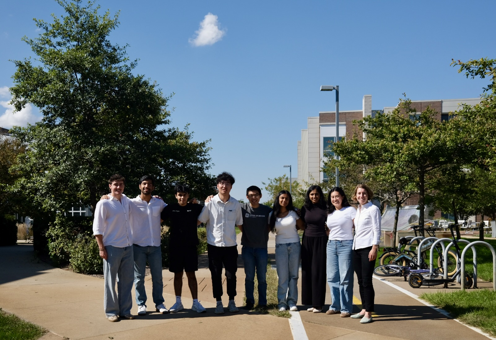

We are a a dynamic, interdisciplinary team of researchers located at the [Department of Visceral, Thoracic and Vascular Surgery, University Hospital Carl Gustav Carus](https://www.uniklinikum-dresden.de/de/das-klinikum/kliniken-polikliniken-institute/vtg) as well as the [Else Kröner Fresenius Center for Digital Health](https://digitalhealth.tu-dresden.de/) at the [Technical University Dresden](https://tu-dresden.de/), Germany. We work at the intersection of medicine, particularly surgery and interventional medicine, and data science. Our overarching goal is to **develop computational tools for quality assurance and decision support in surgery** and to **evaluate such AI-enabled medical devices in patient care settings**. Combining technical knowledge with a clinical perspective on health and disease and an understanding of legal and regulatory requirements, our goal is to drive the clinical translation of novel technologies in the fields of surgery and interventional medicine.

To learn more about our research, please see our [publications](/publications/), meet our [team](/team/) and check out current [opportunities to join the lab](/contact/).

  

 

## Our affiliations

Our lab is located at the [University Medical Center](https://www.uniklinikum-dresden.de/en/university-hospital-carl-gustav-carus) at [Technical University Dresden](https://tu-dresden.de/), Germany. We hold secondary affiliations with [Purdue University](https://www.purdue.edu/)'s [Weldon School of Biomedical Engineering](https://engineering.purdue.edu/BME), the [Department of Surgery](https://medicine.iu.edu/surgery) at [Indiana University School of Medicine](https://medicine.iu.edu/), and the [Department of Biostatistics and Health Data Science](https://fsph.iupui.edu/about/departments/biostatistics/index.html) at [Indiana University](https://www.iu.edu/index.html).