## Principal Investigator

######  

  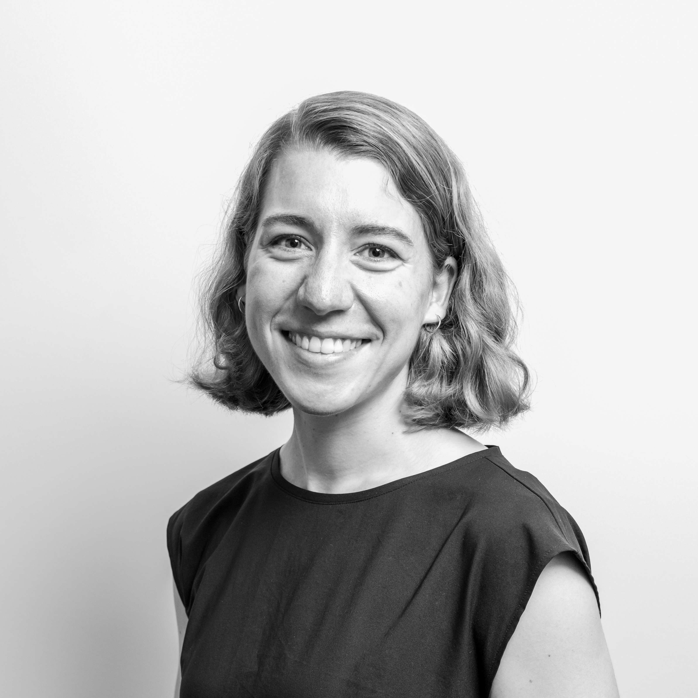
  

    <h4>Fiona Kolbinger, MD, PhD</h4>
    
Fiona is a surgeon scientist and principal investigator at the Department of Visceral, Thoracic and Vascular Surgery and the Else Kröner Fresenius Center for Digital Health at TU Dresden, with adjunct faculty positions at Purdue University (Biomedical Engineering) as well as Indiana University School of Medicine (Department of Surgery). She completed her medical education at the University of Heidelberg School of Medicine and holds a research doctorate in Precision Oncology from the German Cancer Research Center as well as a PhD in Surgical Data Science from TU Dresden. Building on clinical training in general surgery and over a decade of interdisciplinary research experience in Europe and the United States, she conducts translational research at the intersection of surgery and AI. Her works aim to develop computational tools for personalized treatment in surgery and interventional medicine and to evaluate the clinical value of these tools in early-phase clinical trials. Fiona's publications are listed on <a href="https://scholar.google.com/citations?hl=en&user=bH4TiGUAAAAJ">Google Scholar</a> and <a href="https://pubmed.ncbi.nlm.nih.gov/?term=kolbinger+fr">Pubmed</a>.

  

 

## Lab Management

######  

  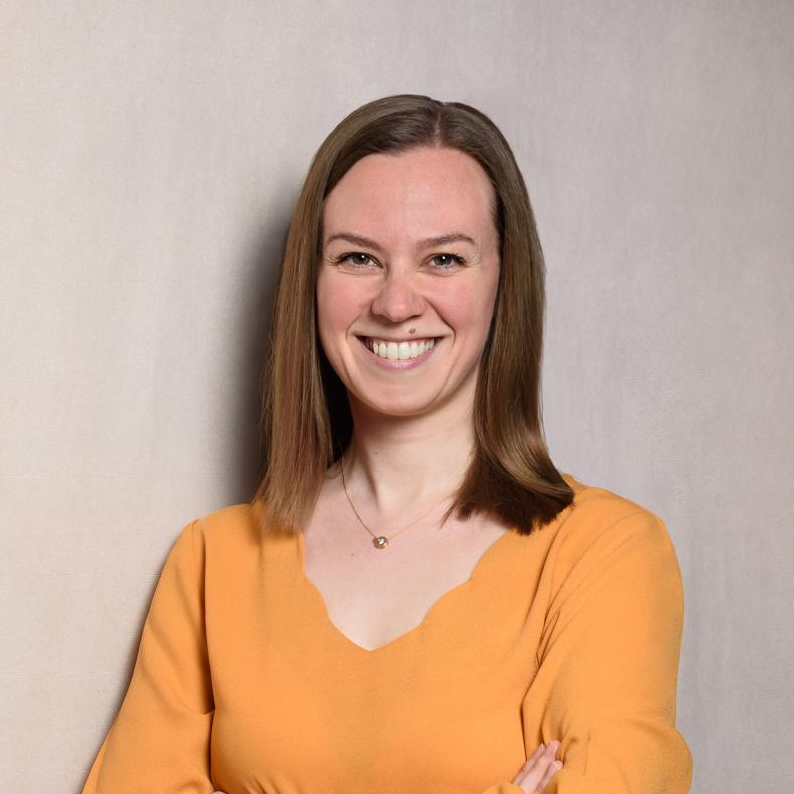
  

    <h4>Sarah Zippusch, PhD</h4>
    
Sarah is a biotechnologist by training and joined our lab as a scientific coordinator in 2026. She completed her undergraduate and graduate education in Medical and Pharmaceutical Biotechnology at IMC Krems, Austria, and holds a PhD in Tissue Engineering from Hannover Medical School. Building on several years of experience conducting and managing research, Sarah supports our group's strategic development and oversees national and international collaborations. Sarah's publications are listed on <a href="https://pubmed.ncbi.nlm.nih.gov/?term=zippusch+s">Pubmed</a>.

  

 

## Researchers

######  

  
  

    <h4>Julia Kleber, MD</h4>
    
Julia is a surgeon scientist at TU Dresden and joined our team in 2026. She holds a bachelor's degree in piano as well as a medical degree and a research doctorate from the University of Regensburg, Germany. Her work in our lab focuses on AI applications for surgical quality assurance and personalized treatment in colorectal surgery. Julia's publications are listed on <a href="https://pubmed.ncbi.nlm.nih.gov/?term=julia+kleber">Pubmed</a>.

  

 

  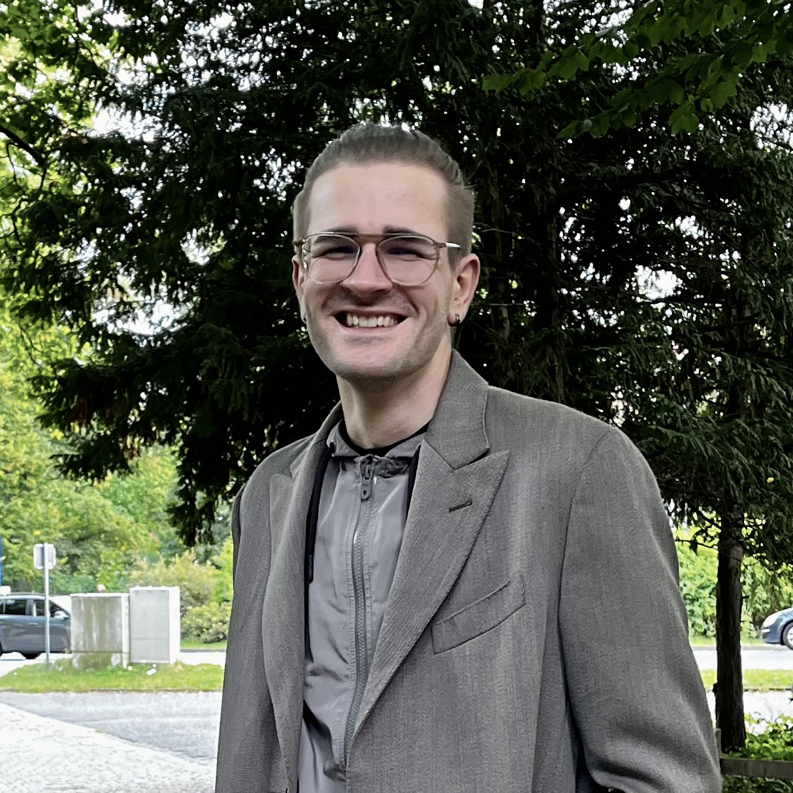
  

    <h4>Matthias Carstens, MD</h4>
    
Matthias joined the lab in 2020 as a medical doctoral student and defended his research thesis in 2024 (magna cum laude). He is now a surgeon scientist at TU Dresden. Matthias has several years of expertise in the compilation and analysis of large-scale datasets of laparoscopic imaging for surgical scene understanding tasks. In addition, he leads early-phase clinical trials of AI-enabled surgical decision support tools. Find Matthias on <a href="https://pubmed.ncbi.nlm.nih.gov/?term=matthias+carstens">Pubmed</a>.

  

 

  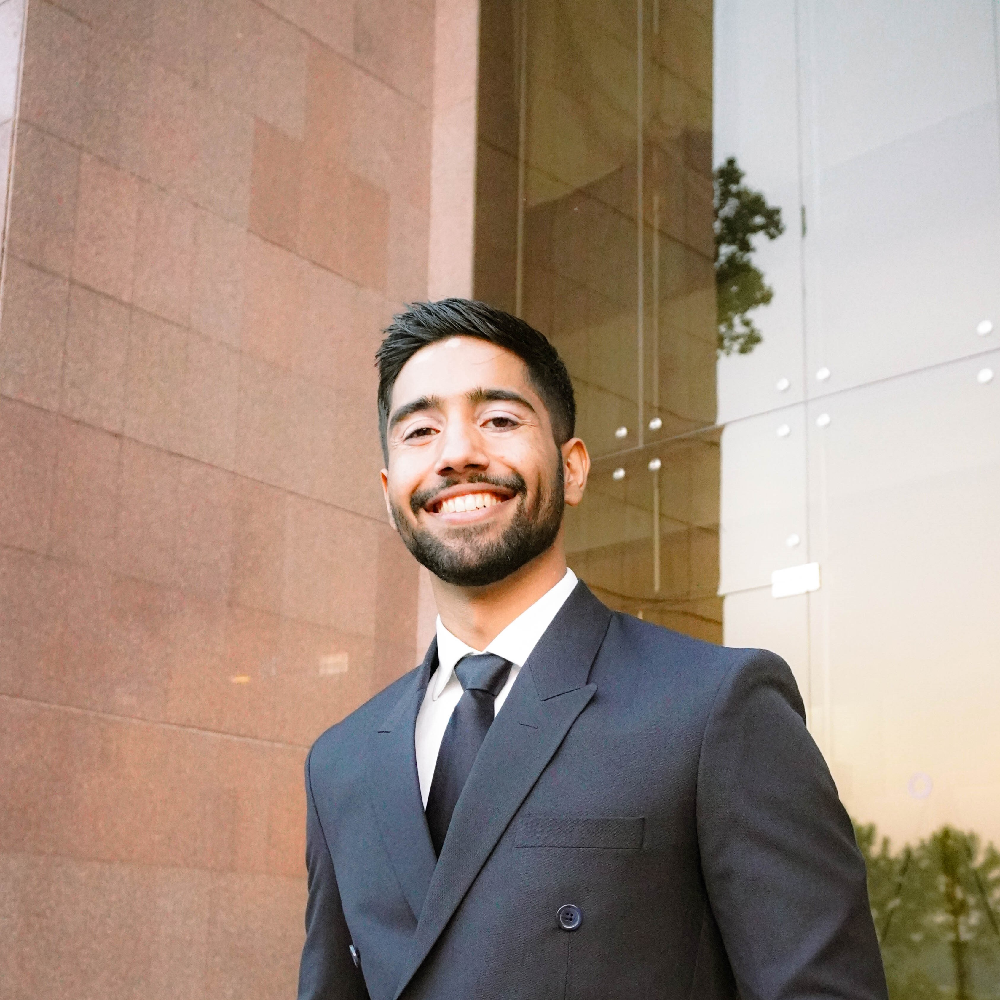
  

    <h4>Muhammad Ibtsaam Qadir, BE, MSc</h4>
    
Ibtsaam joined the team in May 2024 as a graduate researcher in Biomedical Engineering. He completed his undergraduate studies in Electrical Engineering at the National University of Science and Technology in Islamabad, Pakistan in 2023. His research focuses on deep learning-based analysis of medical imaging and multimodal clinical data for the prediction of disease trajectories in patients with pancreatic disease. Find Ibtsaam's publications on <a href="https://scholar.google.de/citations?hl=de&user=pv1eYiAAAAAJ">Google Scholar</a> and <a href="https://pubmed.ncbi.nlm.nih.gov/?term=muhammad+ibtsaam+qadir">Pubmed</a>.

  

 

  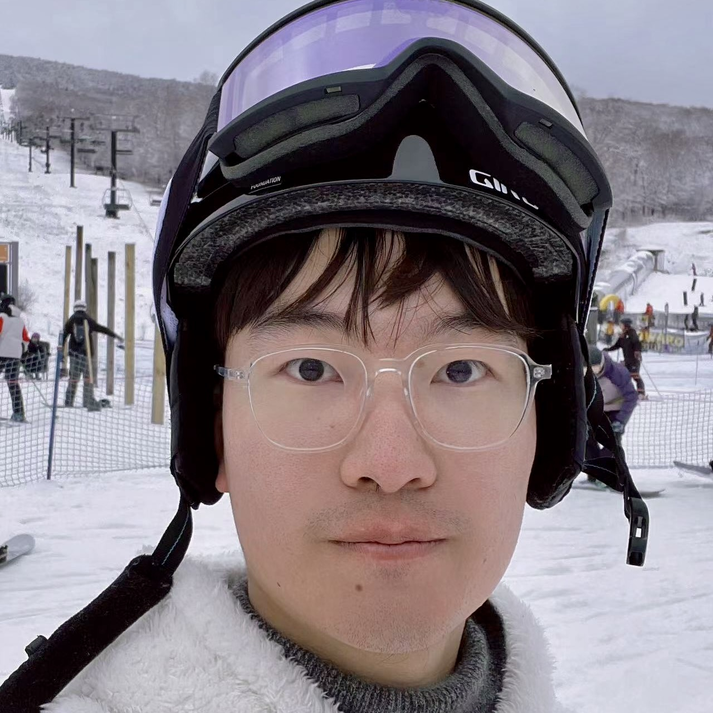
  

    <h4>Zheyuan (Scott) Zhang, MSc</h4>
    
Scott joined the lab in August 2024 as a graduate researcher in Biomedical Engineering. He holds a bachelor's degree in Mechanical Engineering from Zhejiang University in Haining, China and the University of Illinois at Urbana-Champaign and completed his master's degree at Johns Hopkins University in 2024. Building on his experience in surgical image analysis, his research focuses on surgical video understanding for intraoperative surgical decision support and quality assurance. Scott's publications are listed on <a href="https://scholar.google.com/citations?user=KVqTT0EAAAAJ&hl=en">Google Scholar</a> and <a href="https://pubmed.ncbi.nlm.nih.gov/?term=zheyuan+zhang+AND+kolbinger">Pubmed</a>.

  

 

  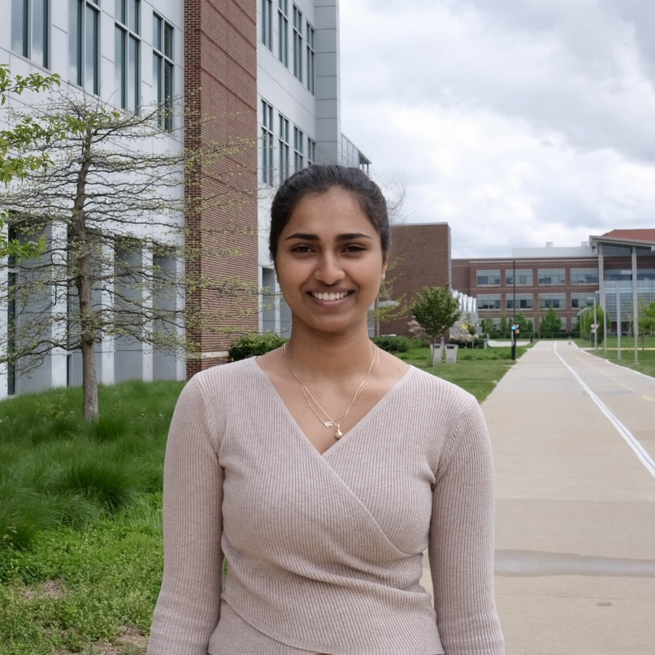
  

    <h4>Natasha Gundapanemi, BS</h4>
    
Natasha studies Electrical and Computer Engineering and joined the lab in August 2024. Following the completion of her undergraduate studies at Purdue University in 2025, she is now a master student in our lab. In her research, Natasha uses qualitative and quantitative methods to increase the explainability and clinical value of computational surgical video analysis models. She is co-advised by Prof. Vijay Gupta at the Elmore Family School of Electrical and Computer Engineering at Purdue University.

  

 

  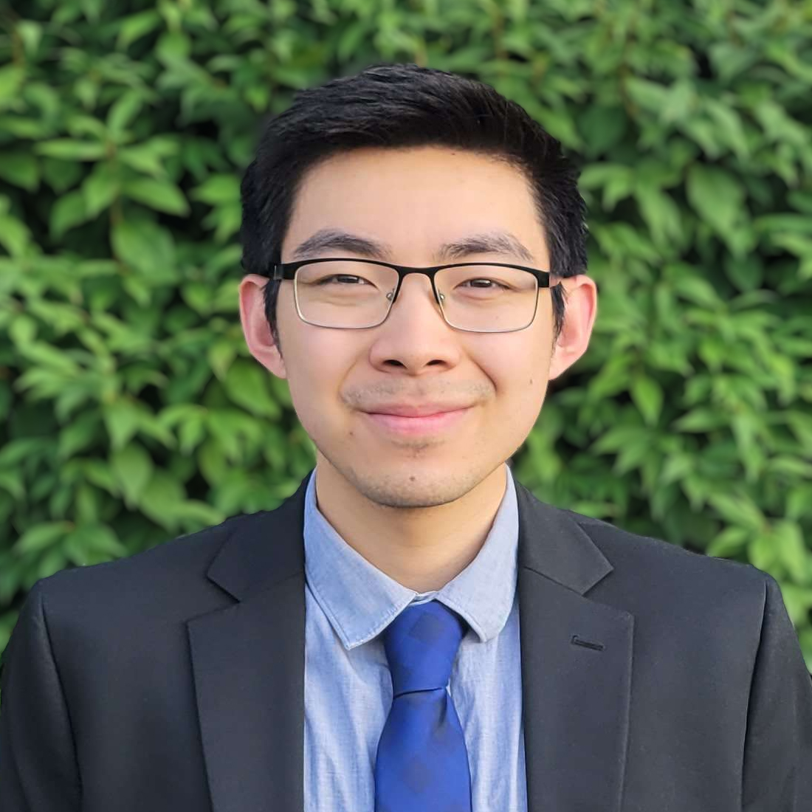
  

    <h4>Evan Zhang, BS</h4>
    
Evan is a medical student at Indiana University West Lafayette and is part of the Biomedical Engineering scholarly concentration. He finished his undergraduate in Biochemistry with a minor in Computer Science at the Ohio State University in 2023. In our lab, Evan's research focuses on quality improvement and complication risk stratification in patients undergoing cardiac interventions. Evan joined the team in September 2024.

  

 

  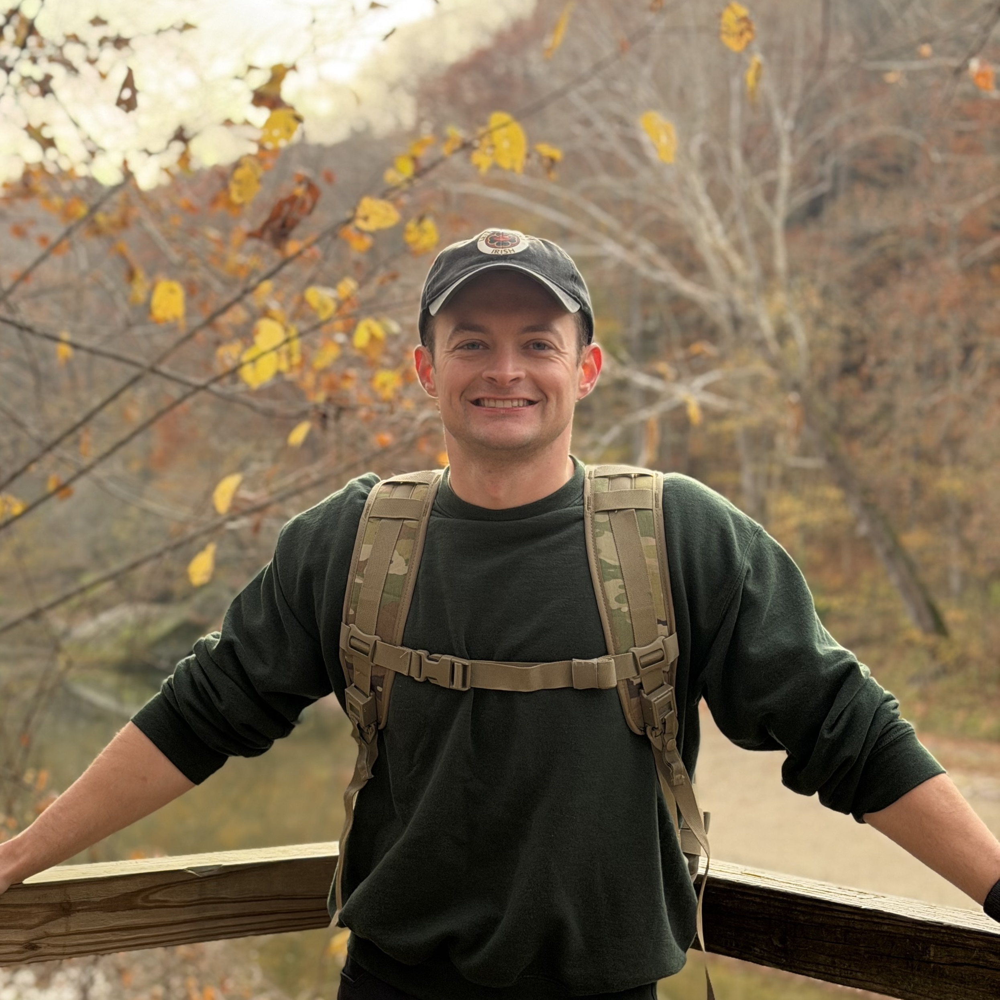
  

    <h4>Ryan Ball, BS, MPAS</h4>
    
Ryan is a medical student at Indiana University West Lafayette and joined our team in December 2025. Following his undergraduate in kinesiology and exercise science at IUPUI, he trained as a physician assistant at the interservice physician assistant school associated with the University of Nebraska Medical Center and worked clinically for several years. Ryan's work in our lab focuses on clinical quality assurance in the management of pancreatic cancer precursors.

  

 

  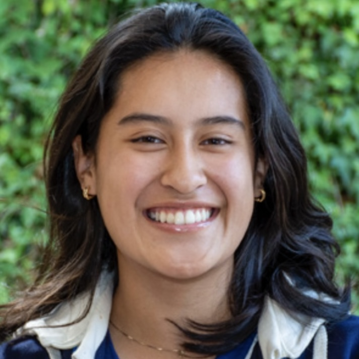
  

    <h4>Maria Moreano</h4>
    
Maria is a Biomedical Engineering undergraduate student with an interest in histopathologic image analysis. She is part of the team since August 2025 and works on digital pathology data from Purdue's veterinary clinic to identify differences and commonalities in disease patterns across various species.

  

 

  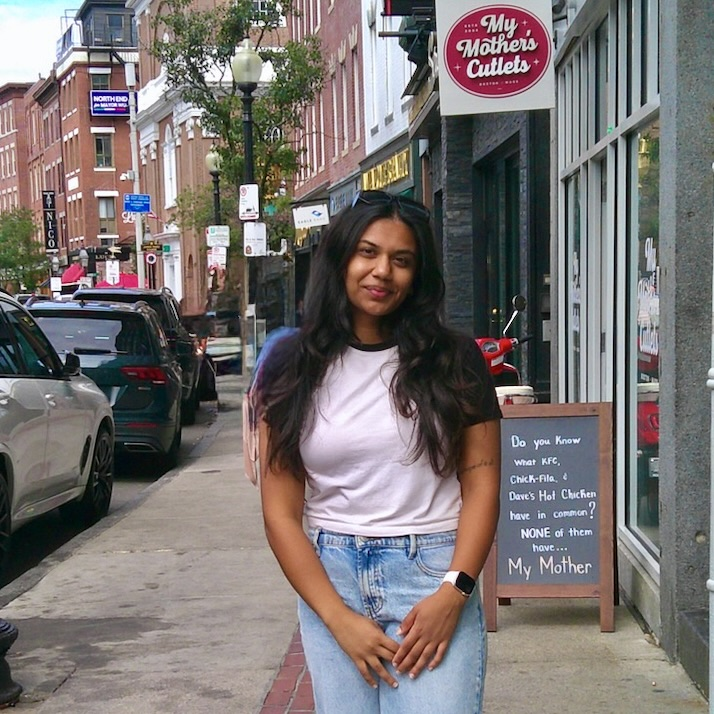
  

    <h4>Medha Belwadi</h4>
    
Medha studies Computer Science and joined the team in August 2025. She is interested in computational analysis of various types of medical imaging data, including endoscopic and histopathological data. In our lab, Medha's research aims to make AI models for laparoscopic surgical video understanding more explainable.

  

 

## Associate Lab Members

######  

  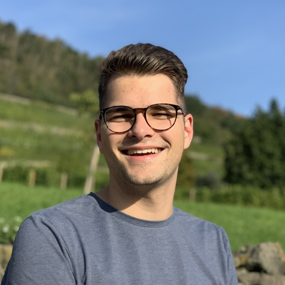
  

    <h4>Kevin Pfeiffer</h4>
    
Kevin is a medical doctoral student at the Technical University Dresden and is co-advised by Prof. Jakob Kather at the Technical University Dresden. Building on years of programming experience, Kevin focuses on the practical implementation of decentralized AI methods, such as Swarm Learning. 

  

<!--  

  
  

    <h4>Hanna Schmeiser</h4>
    
Hanna joined the team as a medical doctoral student in 2022. Her doctoral research focuses on the prediction of postoperative pancreatic fistula after distal pancreatectomy based on multimodal preoperative and intraoperative data. Hanna is co-advised by Prof. Marius Distler at the Technical University Dresden. 

  

-->
 

## Alumni

*Dr. Sophie-Caroline Schwarzkopf, BSc, MD* was a medical doctoral student and a clinician scientist in our group from 2021-2024. She conducted research on educational serious gaming applications in the context of surgical patient care and postoperative complications. Sophie defended her doctoral thesis in 2023 (summa cum laude). Her published works are listed on [Pubmed](https://pubmed.ncbi.nlm.nih.gov/?term=schwarzkopf+sc).

*Thomas Nielen, MD* was a medical doctoral student in our group from 2020-2022 and conducted research on functional outcomes after rectal cancer surgery. Find Thomas on [Pubmed](https://pubmed.ncbi.nlm.nih.gov/?term=nielen+tp).

*Dr. Franziska Rinner, MD* was part of the lab as a medical doctoral student from 2020-2022 and conducted research on intraoperative surgical decision support. She defended her thesis at the Technical University Dresden in 2024 (summa cum laude). Find Fanny's published works on [Pubmed](https://pubmed.ncbi.nlm.nih.gov/?term=franziska+rinner).

 